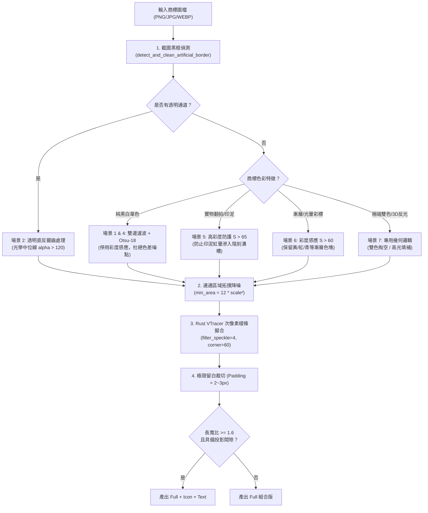

# Logo Vector Master — 高精度商標向量化與去背工作流程

本技能為本專案專屬之工業級商標向量化處理解決方案，專門攻克傳統向量化工具（如 Potrace、原生 VTracer）在處理**現實世界殘缺、翻拍、截圖、低解析度或多色商標**時容易遇到的痛點。

---

## 核心架構與技術棧

* **圖像處理引擎**：Python 3 + OpenCV (`cv2`) + NumPy + Pillow (`PIL`)
* **幾何樣條擬合**：Rust VTracer (`vtracer`) 次像素平滑擬合
* **高精度點陣渲染**：Rust Resvg 引擎 (`resvg_py`)
* **核心入口**：`convert.py` 與 `scripts/core_vectorizer.py`

---

## 八大商標場景處理指南 (Scenario Playbook)

在面對不同來源與體質的商標圖片時，本模組實作了對應的最佳化策略：



---

### 場景 1：標準白底黑字 / 淺底深字 (如 鼎固控股、岳泰建設)
* **痛點**：常規 Otsu 會使筆畫外擴發胖，繁體字內部結構（如「曦」、「麗」、「泰」）容易沾黏融化。
* **解法**：
  1. 使用 **OpenCV 雙邊濾波 (Bilateral Filter)** 消除邊緣階梯噪點，同時嚴格保留邊緣銳利度。
  2. 採用 **Otsu 雙峰自適應門檻 - 18 安全邊界**，精準鎖定筆畫核心骨架，保護繁體字內部負空間。

### 場景 2：透明底反鋸齒字體 (如 皇翔)
* **痛點**：若門檻設定過低（例如 `alpha > 40`），邊緣半透明漸層會向外膨脹 1.5~2px，直接將小英文字母（如 `A`、`R`、`P`）的內孔與三角幾何完全封閉堵死。
* **解法**：
  * 透明通道採樣鎖定**光學中位線門檻 (`alpha > 120`)**，精準還原幾何內孔（孔洞面積與原圖像素點 1:1 還原），保證字體襯線纖細優雅。

### 場景 3：帶有人為截圖黑外框 (如 鼎固控股)
* **痛點**：使用者截圖裁剪時偶爾殘留周圍 1~2px 黑線框，會騙過電腦將畫布判定為深色底，且向量化時會產生一整圈矩形封閉邊框。
* **解法**：
  * 調用 `detect_and_clean_artificial_border()` 比對畫布極外圍 2px 與內側邊緣的亮度落差。當偵測到「內部純白、最外層帶暗框」時，自動將最外圍中和為純白，徹底杜絕外框干擾。

### 場景 4：純單色 Logo 與 JPEG 壓縮色差噪點 (如 ATT 吸引力集團)
* **痛點**：JPEG 4:2:0 色度抽樣在深淺色交界處會產生偽彩色色散（Chroma Fringing，飽和度 $S \approx 20 \sim 40$）。若無差別啟用低飽和度色彩檢測，會在邊界交界處長出微小畸形迴圈（如頂部 $7 \times 4\text{px}$ 噪點）。
* **解法**：
  * 純單色商標嚴格關閉彩色飽和度檢測；通用彩色飽和度閥值提升至 $S > 60$；搭配 `connectedComponentsWithStats` 安全過濾閥值 $\text{min\_area} = 12 \times \text{scale}^2$，精準濾除微塵並保護英文小寫 `i` 的圓點與標點符號。

### 場景 5：實物翻拍 / 印泥油墨滲透 (如 富裔實業)
* **痛點**：紅色印泥蓋在宣紙上翻拍，印泥與米黃色紙張交界處有油墨滲透暈染，傳統二值化會在陰刻白色線條中產生碎屑斑點。
* **解法**：
  * 專用飽和度門檻提升至 $S > 65$ 且 $V < 242$，精準隔絕紙張微弱紅暈，使篆刻線條邊緣如刀刻般平整俐落。

### 場景 6：彩虹漸層與鏡頭光暈 (如 中工 BES)
* **痛點**：黃色、青色等高明度色塊在單純灰階計算中會被誤判為背景白色而被挖空。
* **解法**：
  * HSV 空間飽和度感應：只要具有飽和彩度（$S > 60$ 且非純白 $V < 242$），即使明度接近背景，亦自動判定為前景並保留漸層外觀。

### 場景 7：極端雙色與 3D 鏡面光暈修復
* **崑洲雙色過濾**：海軍藍 (Lum ~32) vs 淺綠 (Lum ~122)，客製門檻 `target_thresh = 80`，將淺綠色過濾為透明負空間，僅提取深色主體。
* **台灣人壽 3D 球體**：
  1. 幾何遮罩補全：將紅球左上方 3D 鏡面白色眩光區域補全為實心白球。
  2. 綠色雙 C 掏空：將紅球下方的綠色 CTBC 雙 C 標誌轉換為透明負空間 (Cutout)。

### 場景 8：邊界留白極小化與圖文自動分離
* **留白極小化**：輸出 SVG 與透明 PNG 均以幾何極限 ViewBox 計算邊界，留白壓縮至 `Padding = 2.0 ~ 3.0px`，完全貼齊實體圖形。
* **圖文分離演算法**：
  * 當整體長寬比 $\text{Width} / \text{Height} \ge 1.6$ 且在橫向 $x \le 40\%$ 區間內偵測到首個顯著空白間隙時，自動將左側獨立為 `Icon`，右側獨立為 `Text`。

---

## 指令列操作手冊 (CLI Usage)

```bash
# 1. 自動掃描 input/ 並批次處理所有檔案至 output/
python convert.py

# 2. 強制重新處理已存在的檔案
python convert.py --force

# 3. 自訂輸出向量顏色 (例如金色)
python convert.py --color #FFD700

# 4. 指定邊界留白間距 (預設為 2px，留白極小化)
python convert.py --padding 2.0

# 5. 停用圖標與文字自動拆分 (僅輸出 Full 完整版)
python convert.py --no-split
```

---

## 輸出成果規範 (Deliverables Spec)

每個處理後的商標將在 `output/<商標名稱>/` 資料夾中產出完整資產：

| 檔案名稱 | 格式 | 說明 |
| :--- | :--- | :--- |
| `*_white_full.svg` | SVG (Vector) | 完整組合版純白向量檔，貼齊邊界，支援無限放大 |
| `*_white_full.png` | PNG (1x) | 原始點陣尺寸純白透明 PNG (resvg 次像素渲染) |
| `*_white_full_4k.png` | PNG (4K) | 超高解析度透明 PNG (長邊 $\ge 4000\text{px}$) |
| `*_white_icon.svg` | SVG (Vector) | 獨立圖標向量檔 (若符合拆分條件) |
| `*_white_icon.png` | PNG (1x) | 獨立圖標透明 PNG |
| `*_white_text.svg` | SVG (Vector) | 獨立標準字向量檔 (若符合拆分條件) |
| `*_white_text.png` | PNG (1x) | 獨立標準字透明 PNG |
| `output/preview.html` | HTML | 離線自包含之視覺對比與一鍵下載看板 |
