# 🎨 LogoSculpt

> **Sculpt pristine, production-ready vector logos and typography from noisy, low-resolution raster images.**  
> 專為真實世界商標、標準字與圖示設計的工業級去背、向量化（Raster-to-SVG）與高解析點陣產出工具。

[](./LICENSE)
[](https://www.python.org/)
[](https://opencv.org/)
[](https://github.com/visioncortex/vtracer)
[](https://github.com/RazrFalcon/resvg)

---

## 🌟 Why LogoSculpt? (為什麼需要 LogoSculpt？)

Traditional vectorization tools (like Potrace or stock VTracer) assume clean input artwork. In the real world, brand assets provided by clients are often:
- Low-resolution web JPEGs with **mosquito noise & compression ringing**.
- Scanned documents or mobile screenshots with **artificial border boxes**.
- Antialiased transparent PNGs whose text strokes **bloat and fuse letter counters** (`A`, `R`, `P`).
- Physical stamp photos with **ink bleed and paper fiber artifacts** inside hollow strokes.
- Multicolor logos with **specular glares or gradients** that get wiped out by basic grayscale binarization.

**LogoSculpt** solves these challenges using an 8-stage computer vision and sub-pixel geometry pipeline:

```mermaid
flowchart LR
    A["Raw Image<br>(PNG/JPG/WEBP/GIF)"] --> B["Artificial Border Neutralizer"]
    B --> C["Bilateral Edge-Preserving Denoise"]
    C --> D["Continuous Cubic 3x Upscaling"]
    D --> E["Adaptive Anti-Dilation Otsu"]
    E --> F["Connected Component Noise Filter"]
    F --> G["Rust VTracer Spline Tracing"]
    G --> H["Tight Bounding Box Trim"]
    H --> I["Auto Icon / Text Splitter"]
    I --> J["SVG + 4K PNG Deliverables"]
```



---

## ✨ Key Features (核心特點)

1. **🛡️ Artificial Screenshot Border Neutralization (人為截圖外框中和)**  
   Automatically compares canvas outer perimeter pixels against interior margins to eliminate accidental 1~2px screenshot borders and prevent false black background classification.

2. **🔍 Sub-Pixel Cubic Upscaling & Spline Fitting (次像素階躍採樣與樣條平滑)**  
   Upscales continuous luminance before binarization to feed Rust VTracer sub-pixel precision coordinates, completely eliminating jagged staircase artifacts on curves.

3. **🔤 Anti-Dilation Typography Preservation (字型排印防發胖防融化)**  
   Employs an adaptive double-peak Otsu threshold with a `-18` safety margin for light backgrounds and an optical midpoint threshold (`alpha > 120`) for transparent PNGs, ensuring letter counters (`A`, `R`, `O`, `P`) and fine serif hooks never get choked.

4. **🧹 Topological Connected-Component De-speckling (連通區域幾何拓撲降噪)**  
   Filters isolated JPEG compression noise and dust specks (`min_area = 12 * scale^2`), cleanly eliminating stray background noise while rigorously preserving punctuation dots and lowercase `i` dots.

5. **🎨 Color Saturation Sensing & Dual-Tone Negative Carving (色彩感應與雙色負空間雕刻)**  
   Distinguishes true brand color gradients (like lens flares and saturated logos) from JPEG chromatic aberration, and cleanly isolates dual-tone logos into transparent negative spaces.

6. **📐 Zero-Margin Tight Bounding Box (極限留白貼齊)**  
   Calculates exact path boundary limits with minimal padding (`padding = 2.0px`), saving designers from manual bounding-box cropping in Illustrator or Figma.

7. **✂️ Automatic Icon / Typography Separation (圖標與標準字智慧拆分)**  
   Analyzes aspect ratio and X-projection gaps (`ratio >= 1.6`, `gap <= 40%`) to automatically deliver three asset variants: **Full**, **Icon**, and **Text**.

8. **📊 Self-Contained Offline Preview Dashboard (離線互動預覽看板)**  
   Generates a standalone `preview.html` with dark mode, brand blue, carbon gray, and checkerboard transparency toggles plus one-click asset downloads.

---

## 📁 Project Structure (專案結構)

```text
LogoSculpt/
├── 📂 input/               👉 Place your input images here (PNG, JPG, WEBP, AVIF, GIF, etc.)
├── 📂 output/              👉 Generated vector assets and preview dashboard
│   ├── preview.html        👉 Interactive visual inspection dashboard
│   └── [Asset_Name]/       👉 Subfolder per asset
│       ├── *_white_full.svg     (Full vector asset)
│       ├── *_white_full.png     (1x transparent PNG)
│       ├── *_white_full_4k.png  (4K ultra-high resolution PNG)
│       ├── *_white_icon.svg     (Isolated Icon vector)
│       └── *_white_text.svg     (Isolated Text vector)
├── 📂 scripts/             👉 Core Python processing pipeline
│   ├── core_vectorizer.py  (Main vectorization & filtering engine)
│   ├── batch_runner.py     (Queue manager & batch CLI runner)
│   └── html_reporter.py    (Interactive preview generator)
├── 📂 skills/              👉 AI Agent skill definition (Logo Vector Master)
├── ⚡ run.bat               👉 Windows 1-click execution script
├── 🛠️ convert.py           👉 Cross-platform CLI entry point
└── 📄 requirements.txt     👉 Python dependencies
```

---

## 🚀 Quick Start (快速上手)

### 1. Installation

```bash
# Clone repository
git clone https://github.com/YuJunWang/LogoSculpt.git
cd LogoSculpt

# Install dependencies
pip install -r requirements.txt
```

### 2. Run Conversion

* **Windows (1-Click)**: Simply double-click `run.bat`.
* **Command Line (Cross-Platform)**:
  ```bash
  python convert.py
  ```

### 3. Inspect Results
Open `output/preview.html` in your browser to inspect the converted vectors and download individual components.

---

## ⚙️ Advanced CLI Options (進階參數)

```bash
# Force re-process all assets (ignore cache)
python convert.py --force

# Custom monochrome fill color (e.g., Gold #FFD700 or Brand Color)
python convert.py --color "#FFD700"

# Adjust edge padding (default: 2.0px, minimal margin)
python convert.py --padding 3.0

# Disable automatic Icon / Text splitting (Full variant only)
python convert.py --no-split

# Custom input and output directories
python convert.py -i "/path/to/inputs" -o "/path/to/outputs"
```

---

## 📖 Scenario Playbook (八大場景處理指南)

Detailed algorithmic instructions and scenario edge-case rules are documented in the project skill:
👉 [skills/logo-vector-master/SKILL.md](./skills/logo-vector-master/SKILL.md)

---

## 📄 License

This project is licensed under the [MIT License](./LICENSE) - see the LICENSE file for details.
